 

`STUDENT DEVELOPER` &nbsp;·&nbsp; `MACAU` &nbsp;·&nbsp; `BUILDING THINGS THAT RUN`

 

## 01 — 关于

我是 **LIN KIT**，澳门濠江中学的一名学生开发者。

白天上课，晚上写代码。喜欢的事很具体：让一段文字变成可以追问的对话，让一张照片变成能逐笔回放的画，让一栋普通骑楼在三维里被记住。

名字里的 *inference* 既是推理，也是「让想法得出结论」的过程 —— 所以我更愿意把好奇心的终点，放在一个**能打开、能操作、能交到别人手上**的东西上。

<table>
<tr>
<td width="33%" valign="top">

**📍 坐标**
澳门，濠江中学

</td>
<td width="33%" valign="top">

**🌱 正在补**
深度学习 · 算法 · 计算机视觉

</td>
<td width="33%" valign="top">

**🕯 一句信条**
先让它跑起来，再让它跑得漂亮。

</td>
</tr>
</table>

 

## 02 — 我在意的事

<table>
<tr>
<td width="50%" valign="top">

### 🔍 证据
结论要能指回原文、指回数据。 
找不到出处的时候，就明说找不到。

</td>
<td width="50%" valign="top">

### 🧱 可交付
不做「看起来快完成」的半成品。 
能跑、能演示、能回退，才算数。

</td>
</tr>
<tr>
<td width="50%" valign="top">

### 🏠 本地优先
数据留在自己的电脑上。 
Markdown 是唯一真源，随时能带走。

</td>
<td width="50%" valign="top">

### 🎨 手感
功能之外，动画的节奏、留白的大小、 
一个按钮按下去的反馈，也值得较真。

</td>
</tr>
</table>

 

## 03 — 工具箱

**语言**

**界面与工程**

**视觉与三维**

 

## 04 — 一些数字

 

 

## 05 — 联系

  

> 如果你也对视觉、三维或者「把想法做成产品」感兴趣，欢迎来聊 ☕

 

© 2026 LIN KIT · Built with curiosity

