 

**学生开发者 · 澳门 · 把想法做成能跑的东西**

 

## 01 — 关于

我是 **LIN KIT**，在澳门濠江中学读书。

喜欢上写代码的理由挺朴素的：看到一个有意思的效果，就想知道它是怎么算出来的；搞明白之后手会痒，忍不住把它做成能点开、能操作、能递给别人的东西。仓库里那些项目，大多就是这么从一个小问题长出来的。

名字里的 *inference* 是推理，也是把想法一步步推到结论 —— 算是个提醒，别只停在想。

- 📍 **坐标** — 澳门 · 濠江中学
- 🌱 **最近在补** — 高等数学、普通物理，还有深度学习
- 🕯 **信条** — 初心高于胜负，成长胜于输赢

 

## 02 — 较真的几件事

说不上是什么原则，就是几件会让我停下来重做一遍的事。

- 🔍 **证据** — 说「书上写过」的时候，我会真的翻到那一页；翻不到，就说翻不到。
- 🏠 **本地优先** — 数据放在自己硬盘上最踏实。Markdown 是唯一真源，换台电脑也能带走。

 

## 03 — 工具箱

`语言`

`界面与工程`

`视觉与三维`

 

## 04 — 一些数字

 

## 05 — 联系

 

> 如果你也在琢磨类似的东西，或者只是想认识一下，开个 Issue 就好。

© 2026 LIN KIT · Built with curiosity

